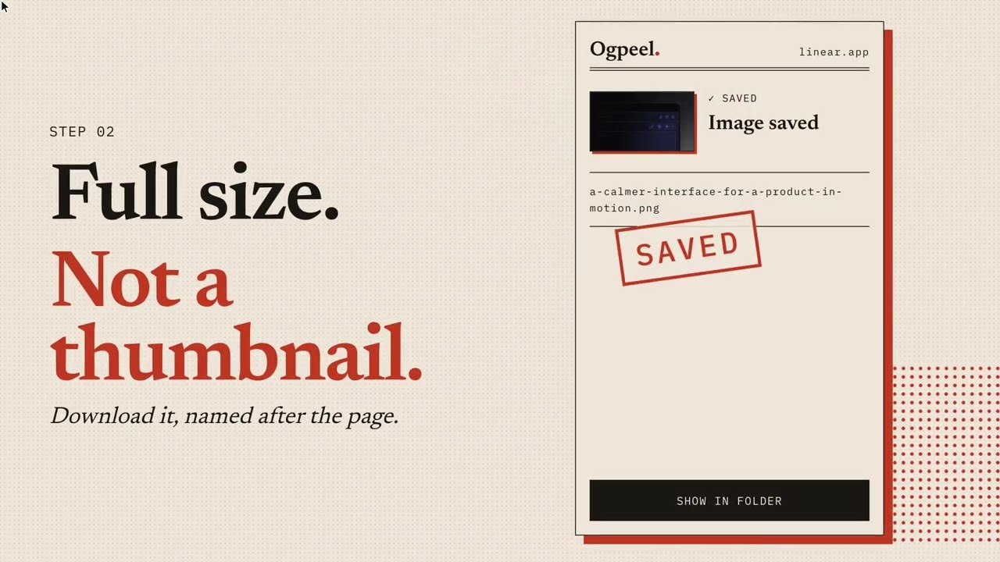

# Ogpeel

Save the image in a link preview. A free, open-source browser extension. [ogpeel.com](https://ogpeel.com)

[Add to Chrome](https://chromewebstore.google.com/detail/jblomcmfnidepcijecnmfnpchkmcneli)

[](https://www.youtube.com/watch?v=IWw3EUP1pn8)

- Download the link preview image full size, or copy the image or its link.
- See every preview image a page sets, or try the largest image when it has none.
- Preview the link on X, LinkedIn, Slack and WhatsApp.
- For developers: get a prompt your coding agent can use to build preview images for your own site.

## Privacy

Ogpeel reads a page only when you click its icon. It has no analytics, error reporting, remote code or remote fonts, and loads only the image the page names. It asks for access to an image's website only when you use Copy image, one site at a time. Your key is checked on your device, never sent.

## Run it

```sh
pnpm install
pnpm dev          # Edge with the extension loaded (pnpm dev:chrome for Chrome)
pnpm test
pnpm build        # then load apps/extension/.output/chrome-mv3 as an unpacked extension
```

More commands are in [CONTRIBUTING.md](CONTRIBUTING.md).

## What's where

- `apps/extension/` the extension
- `apps/frontend/` the website, ogpeel.com
- `apps/worker/` takes payment and emails the key
- `packages/` code more than one app needs: the key format, the prices and the look
- `design/` the designs for the popup, the store listing and the site

## Paying

Ogpeel is free. Developer prompts are free twice; after that, a one-time key unlocks them. The key is checked on your device and never sent. In a development build, `OGPEEL-TEST-TEST-TEST` works as a key.

## Licence

MIT, see [LICENSE](LICENSE). The name "Ogpeel" and its logo are not covered. If you publish a fork, give it another name and logo.
